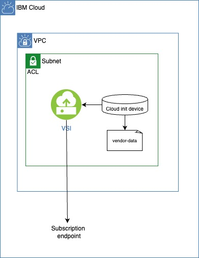

# Introduction
This blog aims to demonstrate how to properly subscribe a RHEL instance in scenarios where the initial subscription attempt fails during the system's first boot. One common cause for this is a lack of connectivity to the subscription endpoint. We will explore this scenario in detail and provide solutions to resolve it. Additionally, the blog will offer an overview of the different subscription models available for registering the operating system, while also explaining the role of cloud-init in managing and automating this process.

# Subscription models for RHEL on IBM Cloud

With the **BYOL** (Bring Your Own License) model, the customer provides their own Red Hat subscription. This model is ideal for organizations that already have an existing Red Hat contract and wish to centralize their usage and support under their own account. Customers can bring their own license through a custom VPC image. These images are registered and licensed by the customer, and the activation of the license is managed directly between the customer and the OS vendor. For more information, please refer to https://cloud.ibm.com/docs/vpc?topic=vpc-byol-vpc-about#byol-vpc-linux

In other hand **IBM-Managed Subscription** is applied when selecting an official RHEL image from the IBM Cloud stock images catalog. The instance is automatically registered to use Red Hat repositories through cloud-init configuration. IBM Cloud provides a cloud-init volume to the instance, allowing the cloud-init service to retrieve the necessary information to configure the machine. This information includes, among other things, the subscription procedure, the URL, the organization, the activation key, and the profile name, all of which are defined in the vendor-data file.

To view the file, simply run the following command
```bash
mkdir /mnt/cloud-init
mount /dev/$(lsblk -f | grep cidata | awk '{print $1}') /mnt/cloud-init
cat /mnt/cloud-init/vendor-data
```



We can summarize the subscription register process on cloud-init  as follows:

| Step                  | Description | Responsible                 |
|---------------------------|-------------------------------------------------------------------|----|
| 1         | VSI Starts up  | IBM |
| 2         | Cloud init service starts  | RHEL |
| 3         | ```DataSourceNoCloud``` is selected  | cloud-init |
| 4         | Cloud-init volume is mounted | cloud-init |
| 5         | ```/var/lib/cloud/instance/``` folder is created from cloud-init volume files  | cloud-init |
| 6         | Init, config and final modules are executed  | cloud-init |
| 7         | scripts-vendor is executed  | cloud-init |
| 8         | ```/var/lib/cloud/instance/scripts/vendor/part-004``` script is executed where the subscription registration takes place	 | RHEL |
| 9         | ```/etc/rhsm/rhsm.conf``` hostname and port is updated | vendor script
| 9         | ```/etc/yum.repos.d/redhat.repo``` is generated | subscription-manager


### Test environment
The following procedure has been tested on the following rhel versions

| RHEL version                  | Cloud init version | VPC Image                                                        |
|---------------------------|-------------------------------------------------------------------|----|
| 8.8          | 22.1-8.el8_8.1  | ibm-redhat-8-8-minimal-amd64-9 |
| 8.10          | 23.4-7.el8_10.8 | ibm-redhat-8-10-minimal-amd64-4 |
| 9.2          | 22.1-10.el9_2  | ibm-redhat-9-2-minimal-amd64-8 |
| 9.4          | 23.4-7.el9_4.11  | ibm-redhat-9-4-minimal-amd64-7 |


VSI profile used
* Profile ```cx3d-2x5```

# Subscribe your RHEL OS on IBM Cloud after a subscription error during provisioning
### Step 1. Review that your RHEL hasn't be subscribed
```bash
subscription-manager status
```
In sush case you will see
```bash
+-------------------------------------------+
   System Status Details
+-------------------------------------------+
Overall Status: Unknown

\ Checking server status
```

We have identified several scenarios where this issue could occur:

* Lack of network connectivity to the subscription endpoint.
* A user has forced a re-registration using the command: ```subscription-manager register --force``` and the procedure hadn't finished.

### Step 2. How to check which is the subscription RHEL host and port used
```bash
export RHEL_SUBSCRIPTION_HOSTNAME=$(cat /var/lib/cloud/instance/scripts/vendor/part-004 | grep -E "^REDHAT_CAPSULE_SERVER" | cut -d'=' -f 2 | sed 's/"//g')
export RHEL_SUBSCRIPTION_PORT=8443
```
On ```eu-es``` the values are
* hostname: ```rhha01.updates.eu-es.iaas.service.networklayer.com, rhha02.updates.eu-es.iaas.service.networklayer.com```
* port: 8443

### Step 3. Check connectivity
```bash
curl -v telnet://$RHEL_SUBSCRIPTION_HOSTNAME:$RHEL_SUBSCRIPTION_PORT
```
If you don't see something like
```bash
*   Trying 161.26.216.24:8443...
* Connected to rhha02.updates.eu-es.iaas.service.networklayer.com (161.26.216.24) port 8443 (#0)
```
You must review the ```security groups``` attached to the VNI bound to your VSI, as well as the ```access control lists``` associated with the subnet where the instance resides, to ensure traffic is allowed on the specified IP and port


### Step 4. Subscribe it
We will proceed by restarting the cloud-init procedure. The component responsible for subscribing your RHEL OS is cloud-init, through the ```scripts-vendor``` module, which is located under ```cloud_config_modules``` in the ```/etc/cloud/cloud.cfg``` file. Config modules are executed once during the machine's first startup. To force another execution, we simply need to do the following:

```bash
cloud-init clean
reboot
```
### Deeper explanation
The responsible for performing finally the subscription is the ```/var/lib/cloud/instance/scripts/vendor/part-004``` file. The ```scripts-vendor```module will run the bash files located at ```/var/lib/cloud/instance/scripts/vendor``` directory. This structure and files are built previously by other ```cloud-init``` modules using the ```vendor-data``` file located on the ```cloud-init volume``` provided by IBM Cloud. 

Script vendor source code
```
https://github.com/canonical/cloud-init/blob/main/cloudinit/config/cc_scripts_vendor.py
```

# Summary
This blog explains how to properly subscribe a RHEL instance when the initial subscription fails during the first boot, often due to connectivity issues with the subscription endpoint. It also covers various subscription models for registering the OS and the role of cloud-init in automating and managing the subscription process

# FAQ's
### 1. How can you determine which volume is the cloud-init volume?
Through label ```cidata```
```bash
lsblk -f | grep cidata
```
excepted output
```bash
/dev/vdc: LABEL="cidata" TYPE="iso9660"
```
To understand how cloud-init determines its, take a look at https://github.com/canonical/cloud-init/blob/main/cloudinit/sources/DataSourceNoCloud.py

### 2. How to subscribe your RHEL OS through rh_subscription on userdata?
Don't recommended if you are in a IBM-Managed Subscription model
```bash
 rh_subscription:
        rhsm-baseurl: "rhsm-baseurl"
        server-hostname: "server-hostname"
        add-pool: "add-pool"
        activation-key: "activation-key"
        org: "org"
        auto-attach: true
        enable-repo:
          - "rhel-9-for-x86_64-baseos-rpms"
          - "rhel-9-for-x86_64-appstream-rpms"
        service-level: "standard"
```

### 3. How to subscribe your RHEL OS manually?
Don't recommended if you are in a IBM-Managed Subscription model

### Way 1
```bash
source /var/lib/cloud/instance/scripts/vendor/part-004
```
### Way 2
Use ```subscription-manager register``` command. You have to locate all those variables in ```/var/lib/cloud/instance/scripts/vendor/part-004``` file
```bash
OS_REDHAT_ORG_NAME=$(cat /var/lib/cloud/instance/scripts/vendor/part-004 |grep -E "^OS_REDHAT_ORG_NAME" | cut -d'=' -f 2 | sed 's/"//g')
ACTIVATION_KEYS=$(cat /var/lib/cloud/instance/scripts/vendor/part-004 |grep -E "^ACTIVATION_KEYS" |awk -F'ACTIVATION_KEYS=' '{print $2}'| sed 's/"//g')
PROFILENAME=$(cat /var/lib/cloud/instance/scripts/vendor/part-004 |grep -E "^PROFILENAME" | cut -d'=' -f 2 | sed 's/"//g')
REDHAT_CAPSULE_SERVER=$(cat /var/lib/cloud/instance/scripts/vendor/part-004 |grep -E "^REDHAT_CAPSULE_SERVER" | cut -d'=' -f 2 | sed 's/"//g')
sudo subscription-manager register --org="${OS_REDHAT_ORG_NAME}" --activationkey="${ACTIVATION_KEYS}" --name="${PROFILENAME}" --baseurl="https://${REDHAT_CAPSULE_SERVER}/pulp/repos" --force
```
### 4. How to check the Datasource used?
```bash
cloud-init status --long
```
or 
```bash
/var/lib/cloud/instance/datasource
```
Excepted output is
```bash
DataSourceNoCloud: DataSourceNoCloud [seed=/dev/vdb][dsmode=net]
```

### 5. Who is responsible of mounting cloud init volume?
```DataSourceNoCloud.py``` file

# References
* https://github.com/canonical/cloud-init/blob/main/cloudinit
* https://cloud.ibm.com/docs/vpc?topic=vpc-user-data
* https://cloud.ibm.com/docs/image-templates?topic=image-templates-using-your-own-os-license-or-subscription
* https://cloud.ibm.com/docs/vpc?topic=vpc-byol-vpc-about#byol-vpc-linux

# Authors
* Jorge Hernández Ramírez (jorgehernandezramirez@ibm.com)
* Francisco Javier Ramos Muñoz (fco_ramos@es.ibm.com)